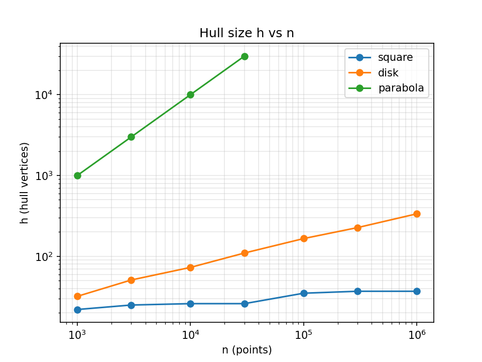
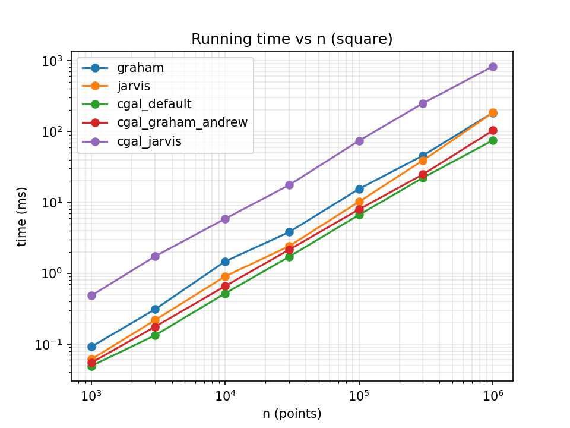
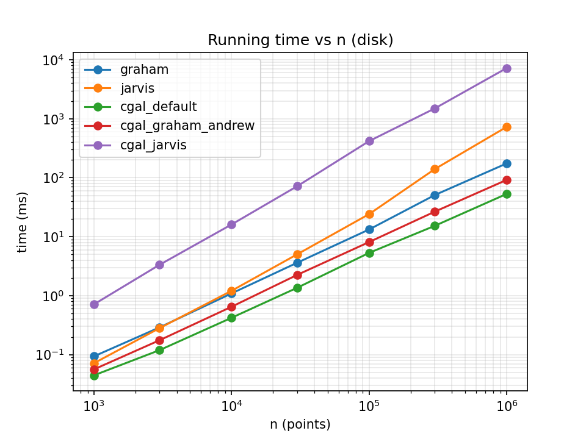
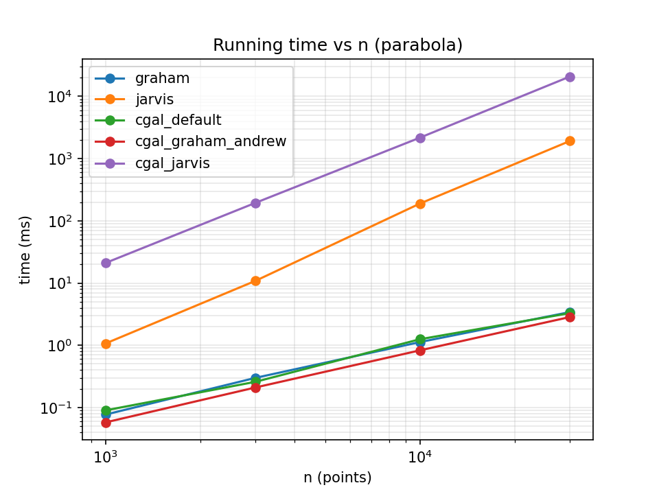

# Lab 4.3 · Convex Hulls in Practice — Report

**TC2038 Analysis and Design of Advanced Algorithms**
Team: Diego Rodríguez Sánchez (A01742085) · Omar Avila Meza (A01743547)

---

## Part 0 · Setup

CGAL was installed through MSYS2 (`pacman -S mingw-w64-ucrt-x86_64-cgal`). Output of `cgal_hello` on `example13.txt`:

```
5
192 146
312 56
684 86
720 170
420 308
```

These are the 5 expected vertices in counter-clockwise order, but CGAL starts at `(192,146)` instead of the lowest point `(312,56)`.

Parts 4, 6 and the bonus were run on Fedora Linux, where CGAL was installed with `sudo dnf install CGAL-devel`, so the timings in Part 4 come from that machine.

### Question 0
To compare two implementations automatically, their outputs must be **identical element by element**. The same convex polygon can be written in many ways: it can start at any of its h vertices, be traversed clockwise or counter-clockwise, and include or omit the collinear points lying in the middle of an edge. Without a fixed convention, an `==` would flag two correct results as different. That is why we fix: extreme points only, no duplicates, counter-clockwise order, starting at the lowest point (smallest `y`; ties broken by smallest `x`). With that, normalizing CGAL's output (with a `std::rotate`) is enough to compare thousands of cases without checking them by hand.

---

## Part 1 · The orientation test and Graham scan

### Implementation
- **`orient(a, b, c)`** computes `(bx − ax)(cy − ay) − (by − ay)(cx − ax)` using only `long long`. It returns the full value, not just its sign, because its magnitude (twice the area of triangle abc) is used by the rotating calipers in Part 5.
- **`graham(P)`**:
  1. `sort` + `unique` + `erase` with `operator<` to remove duplicates. If fewer than 3 points remain, they are returned as they are (since they are sorted, the lowest point comes first).
  2. Because of that ordering, `P[0]` is already the pivot p0 (lowest point; ties broken by leftmost).
  3. The remaining points are sorted by angle around p0 with a comparator built on `orient`: `a` comes before `b` if `orient(p0, a, b) > 0`; if they are collinear, the closer one comes first (`dist2`).
  4. Scan with a stack `H`: before pushing `p`, pop the top while `orient(H[-2], H[-1], p) ≤ 0`. The `≤` also removes collinear points lying in the middle of an edge.

All 4 test files (`example13`, `square_degenerate`, `collinear` and `single`) produce exactly the expected output.

### Question 1.1 · Can `orient` overflow?
With |x|, |y| ≤ 10⁹:

| Term | Maximum value |
|---|---|
| Each difference, e.g. `bx − ax` | 10⁹ − (−10⁹) = **2·10⁹** |
| Each product, e.g. `(bx − ax)(cy − ay)` | (2·10⁹)² = **4·10¹⁸** |
| The result (difference of two products) | 4·10¹⁸ + 4·10¹⁸ = **8·10¹⁸** |

A signed 64-bit `long long` goes up to 2⁶³ − 1 ≈ **9.22·10¹⁸**. Since 8·10¹⁸ < 9.22·10¹⁸, neither the intermediate products nor the result overflow (although the margin is small).

If coordinates could reach **10¹⁰**, differences would be up to 2·10¹⁰ and products up to 4·10²⁰, which **does** overflow 64 bits. The fix would be to compute the products in `__int128` (up to ~1.7·10³⁸) and compare only the sign. Using `double` would **not** work, because it loses exactness: it only represents integers exactly up to 2⁵³ ≈ 9·10¹⁵.

### Question 1.2 · Which points are popped in the class example?
Angular order around p0 = (312,56): p0, p1, p2, …, p12. In this example it matches the numbering used in class.

| When processing | Popped | Why |
|---|---|---|
| p3 (720,170) | p2 (636,104) | p1 → p2 → p3 turns right |
| p5 (576,194) | p4 (612,152) | |
| p6 (492,218) | p5 (576,194) | |
| p9 (402,224) | p8 (378,146), then p7 (420,200) | two pops in a row |
| p10 (420,308) | p9 (402,224), then p6 (492,218) | two pops in a row |
| p12 (192,146) | p11 (288,170) | |

There are **8 pops** in total, in the order **p2, p4, p5, p8, p7, p9, p6, p11**. The stack ends with **p0, p1, p3, p10, p12** = (312,56) (684,86) (720,170) (420,308) (192,146), which is the expected hull.

**Why is the scan O(n) even though the `while` loop can pop many points at once?** By amortized analysis: every point is pushed onto the stack **exactly once** and popped **at most once**. So the total number of pops over the whole scan is ≤ n, even if a single step pops several. There are n pushes and ≤ n pops, so the scan costs O(n). The overall O(n log n) cost of Graham scan is dominated by the sort.

---

## Part 2 · Jarvis march

### Implementation
Same preprocessing as Graham (remove duplicates and handle n < 3). Starting from `start = P[0]` (the lowest point), each iteration pushes `current` onto the hull and searches for the next vertex: it takes a candidate `next` and, for every point `r ≠ current`, computes `orient(current, next, r)`:
- if it is **< 0** (r lies to the right of current → next), `r` becomes the new candidate;
- if it is **= 0** (collinear) and `r` is **farther** from `current`, `r` is also taken, so points in the middle of an edge are not reported.

The loop (`do … while`) stops when it returns to `start`. Every call to `orient` is counted and the total is stored in `*tests`. The outputs of Jarvis and Graham are identical on all 4 test files.

### Question 2
On `example13.txt` (n = 13, h = 5) our Jarvis march performs **60 orientation tests**:

```
Get-Content data\example13.txt | .\main.exe jarvis   →   orientation tests = 60
```

Each of the **h** iterations (one per hull vertex) compares the candidate against the other **n − 1** points, so:

**tests = h · (n − 1) = 5 · 12 = 60**

**Worst case:** when **every point is extreme** (h = n), for example points on a parabola `y = x²` or on a circle. The algorithm then performs n · (n − 1) tests, i.e. **Θ(n²)**. For n = 30 000 (the largest parabola in the benchmark) that is 30 000 · 29 999 = 899 970 000 ≈ 9·10⁸ orientation tests, exactly the number that `bench` measured in Part 4.

---

## Part 3 · Stress testing against CGAL

### Implementation
- **`cgal_hull`**: after `CGAL::convex_hull_2`, the result is rotated so that it starts at the lowest point:
  `std::rotate(H.begin(), std::min_element(H.begin(), H.end()), H.end());`
  (`min_element` uses our `operator<`, which defines "lowest, then leftmost").
- **Hard cases:** besides the random points, depending on the seed we add
  - `seed % 3 == 1` → **duplicates**: up to 5 existing points are inserted again;
  - `seed % 3 == 2` → **collinear points on an edge**: the points (−1000 + 500k, −10⁹) for k = 0..4, which lie on the bottom edge. Only the two endpoints should appear in the hull.

Result on 3000 inputs (1000 seeds × 3 distributions):

```
OK: 0 mismatches
```

### Question 3
**Bugs found:** none. Graham and Jarvis already handled both degenerate cases by design: duplicates are removed with `sort` + `unique` before starting, and collinear points are excluded by the `≤ 0` condition in Graham's stack and by the "keep the farthest point" rule in Jarvis.

**Why is it safe to convert the coordinates to `double` before calling CGAL?** A `double` has a 53-bit mantissa, so it represents **exactly** every integer with |k| ≤ 2⁵³ ≈ 9.007·10¹⁵. Our coordinates satisfy |x|, |y| ≤ 10⁹ < 2⁵³, so the conversion loses no information and CGAL receives exactly the same points.

**Which kernel do we use, and what does it mean?** `CGAL::Exact_predicates_inexact_constructions_kernel` (EPICK):
- **Exact predicates:** questions that return a discrete decision (such as the left/right/collinear orientation) always give the correct answer. CGAL first evaluates them with interval arithmetic on `double` and, only if the result is ambiguous, recomputes them with exact arithmetic (GMP/MPFR).
- **Inexact constructions:** operations that create new geometric objects (e.g. the intersection point of two segments) are computed in `double` and may have rounding error.

The convex hull only uses **predicates** (it never constructs new points; it only selects points from the input), so with EPICK the result is exact and also fast.

---

## Part 4 · Experiments: when does h matter?

### Implementation
- **`bench.cpp`**: for every distribution and every n, besides our `graham` we now also time our `jarvis` (printing its number of orientation tests too), `CGAL::convex_hull_2` (CGAL's default), `CGAL::ch_graham_andrew` and `CGAL::ch_jarvis`. The CGAL functions write their hull into a new `std::vector<P2>` through `std::back_inserter`. The conversion of the points to CGAL's type is done before starting the timer, so it is not part of the measurement.
- Both Jarvis versions are skipped when n · h > 2·10⁹, as the guide asks. With the sizes used in the starter kit this never happens (the largest product is 30 000 · 30 000 = 9·10⁸), so every algorithm was measured on every input.
- `./bench > results/results.csv` (Release build) took about 38 seconds on our machine.
- **`plot.py`** reads `results/results.csv` with matplotlib and saves the four log-log plots in `results/`. It also prints the slope of each h vs. n line, which we use in question 4(a).

**Sanity check:** our hull sizes match the ones given in the guide exactly (h = 22, 26, 35, 37 for the square and h = 32, 73, 166, 336 for the disk at n = 10³, 10⁴, 10⁵, 10⁶), so our generator produces the same points.

### Plots
**(a) Hull size h vs. n**



**(b) Running time vs. n, one plot per distribution**





### Timings (ms)

**Square**
| n | h | `graham` | `jarvis` | `cgal_default` | `cgal_graham_andrew` | `cgal_jarvis` |
|---|---|---|---|---|---|---|
| 1 000 | 22 | 0.09 | 0.06 | 0.05 | 0.05 | 0.48 |
| 3 000 | 25 | 0.31 | 0.22 | 0.13 | 0.18 | 1.73 |
| 10 000 | 26 | 1.47 | 0.90 | 0.52 | 0.66 | 5.87 |
| 30 000 | 26 | 3.80 | 2.41 | 1.70 | 2.14 | 17.48 |
| 100 000 | 35 | 15.47 | 10.20 | 6.66 | 7.96 | 74.03 |
| 300 000 | 37 | 45.65 | 38.98 | 22.18 | 24.75 | 249 |
| 1 000 000 | 37 | 184 | 184 | 74.97 | 103 | 827 |

**Disk**
| n | h | `graham` | `jarvis` | `cgal_default` | `cgal_graham_andrew` | `cgal_jarvis` |
|---|---|---|---|---|---|---|
| 1 000 | 32 | 0.09 | 0.07 | 0.04 | 0.06 | 0.71 |
| 3 000 | 51 | 0.29 | 0.28 | 0.12 | 0.18 | 3.34 |
| 10 000 | 73 | 1.09 | 1.21 | 0.42 | 0.65 | 16.09 |
| 30 000 | 110 | 3.62 | 5.02 | 1.36 | 2.25 | 71.70 |
| 100 000 | 166 | 13.26 | 24.15 | 5.32 | 8.11 | 418 |
| 300 000 | 227 | 50.81 | 140 | 15.29 | 26.59 | 1 496 |
| 1 000 000 | 336 | 175 | 728 | 53.18 | 91.93 | 7 233 |

**Parabola**
| n | h | `graham` | `jarvis` | `cgal_default` | `cgal_graham_andrew` | `cgal_jarvis` |
|---|---|---|---|---|---|---|
| 1 000 | 1 000 | 0.08 | 1.07 | 0.09 | 0.06 | 21.04 |
| 3 000 | 3 000 | 0.30 | 10.87 | 0.26 | 0.21 | 195 |
| 10 000 | 10 000 | 1.12 | 189 | 1.25 | 0.83 | 2 169 |
| 30 000 | 30 000 | 3.41 | 1 917 | 3.28 | 2.84 | 20 803 |

### Questions 4
**(a) Slope for the disk.** On a log-log plot, a quantity that grows like nᵏ shows up as a straight line with slope k. For the disk, n goes from 10³ to 10⁶ (×1000) while h goes from 32 to 336 (×10.5), so the slope is log(336/32) / log(1000) ≈ **0.340**. This is very close to 1/3 ≈ 0.333, so it agrees with h = Θ(n^(1/3)). For comparison, the parabola gives a slope of exactly 1 (h = n) and the square only 0.075, because log n grows slower than any power of n and its line keeps getting flatter.

**(b) Where is Jarvis march competitive?** On the **square**. There h stays tiny (at most 37 points for a million inputs), so Jarvis' O(nh) cost is close to a linear pass over the points repeated a few dozen times, which is comparable to the n log n of Graham scan (log₂ 10⁶ ≈ 20). In practice our Jarvis was even faster than our Graham up to n = 300 000 (e.g. 10.2 ms vs. 15.5 ms for n = 10⁵) and tied at n = 10⁶ (184 ms both). Each Jarvis step is very cheap (one `orient` over an array read in order), while Graham has to sort with a heavier comparator. On the disk, h grows like n^(1/3), so Jarvis costs about n^(4/3): it is still close for small n but ends up about 4 times slower at n = 10⁶.

**(c) Jarvis on the parabola.** Every point is on the hull (h = n), so Jarvis performs exactly n(n − 1) orientation tests, which is Θ(n²). When n is multiplied by 10 the number of tests grows by 100 (999 000 → 99 990 000 from n = 10³ to 10⁴), and the time grows by about 177 (1.07 ms → 189 ms; the same happens from 3 000 to 30 000: 10.9 ms → 1 917 ms). The slope of its line in the plot is about 2, which is what the theory predicts. The time grows a bit more than ×100, most likely because of memory effects: as n grows the points no longer fit in the fastest cache levels, so each test becomes slightly more expensive.

**(d) Why does Akl–Toussaint help on the square and the disk but not on the parabola?** The heuristic finds the four extreme points (in x and y) in a single O(n) pass and throws away every point inside the quadrilateral they form, because those points can never be on the hull. In a square or a disk, almost all the points fall inside that quadrilateral, so the real hull algorithm only runs on a small fraction of the input. That is why `cgal_default` is the fastest there (75 ms vs. 103 ms for `cgal_graham_andrew` on the square and 53 ms vs. 92 ms on the disk, both at n = 10⁶). On the parabola every point is extreme, so none of them lies inside the quadrilateral and nothing is discarded. The heuristic becomes an extra pass that does not pay off, and `cgal_default` ends up slightly slower than `cgal_graham_andrew` (3.28 ms vs. 2.84 ms at n = 30 000).

---

## Part 5 · Application: fencing an orchard

### Implementation
All three functions work only on the hull `H` returned by `graham`, which is counter-clockwise and has no repeated or collinear points.
- **`perimeter(H)`** adds the length of every edge Hᵢ → Hᵢ₊₁, including the last one that closes the polygon (we use the index `(i + 1) % h` to go back to H₀). The length of each edge is `sqrt(dist2(...))`, so this is the only result in `double`. The shortest fence is exactly the hull because any fence that encloses all the trees must also enclose their convex hull, and if a fence has a part that bends inwards, replacing it with a straight segment makes it shorter while still enclosing everything.
- **`twice_area(H)`** uses the shoelace formula 2A = Σ (xᵢ·yᵢ₊₁ − xᵢ₊₁·yᵢ). Each term is the orientation (twice the signed area) of the triangle formed by the origin and one edge; when we add them all, the parts outside the polygon cancel and only its area remains. Everything is computed with `long long`, so the result is exact; we only divide by 2 when printing. Since the hull is counter-clockwise, the result is positive.
- **`diameter2(H, a, b)`** uses rotating calipers. For each edge (Hᵢ, Hᵢ₊₁) a second index `j` moves forward while `orient(Hᵢ, Hᵢ₊₁, Hⱼ₊₁)` keeps growing, which means that Hⱼ₊₁ is farther from that edge. When it stops, Hⱼ is the vertex farthest from the edge, and we compare the pairs (Hᵢ, Hⱼ) and (Hᵢ₊₁, Hⱼ) using `dist2`. The index `j` never goes back, so it goes around the hull only once and the whole function is O(h).

The degenerate cases work without extra code: with 2 points the area cancels to 0 and the diameter is the segment itself; with 1 point everything is 0.

Output for `example13.txt`, the same as in the guide:

```
h = 5
perimeter = 1224.508
area = 80316.000
diameter = 528.545  between (720, 170) and (192, 146)
```

We also added a mode `./app brute` that compares the rotating calipers with an O(n²) brute force and times both (question 5b).

### Questions 5
**(a) Why is the farthest pair always made of two hull vertices?** Take the farthest pair (p, q) and suppose that p is not a hull vertex, so it lies inside the hull or in the middle of an edge. Then p is in the middle of some segment uv whose endpoints are also in the hull (if p is on an edge, u and v are the endpoints of that edge; if it is inside, any segment through p works). Along a straight line, the distance to a fixed point q has no maximum in the middle of a segment: it is always largest at one of the two endpoints. So u or v is farther from q than p, which contradicts that (p, q) was the farthest pair. Repeating the argument for q, both points must be hull vertices.

**(b) Validation and running time.** `./app brute` generates 3000 random inputs (square, disk and parabola, with 1 to 200 points each) and compares the squared diameter given by the rotating calipers with the one from an O(n²) brute force that checks every pair of points. We compare the distance and not the pair itself because two different pairs can have the same distance. Result:

```
validation: 0 mismatches in 3000 random inputs
n = 100000, h = 24
brute force O(n^2):        4830.553 ms
hull + calipers O(n log n): 13.805 ms
same diameter
```

For n = 10⁵ points in a square, the brute force checks about n²/2 = 5·10⁹ pairs and takes 4.8 s, while the hull plus the calipers takes 14 ms, about 350 times faster. The whole pipeline costs O(n log n) for the Graham scan plus O(h) for the calipers, so it is **O(n log n)** in total. Building the hull is the expensive part: the calipers only had to look at 24 vertices.

**(c) Can `twice_area` overflow a `long long`?** With |x|, |y| ≤ 10⁹ it does not, but the margin is small. Each product xᵢ·yᵢ₊₁ is at most 10¹⁸ and each term at most 2·10¹⁸. The final result is twice the area of the hull, and the hull lies inside the square [−10⁹, 10⁹]², whose area is 4·10¹⁸, so 2A ≤ 8·10¹⁸ < 2⁶³ − 1 ≈ 9.22·10¹⁸. The partial sums are also safe: each term is twice the signed area of the triangle formed by the origin and one edge, and the positive triangles do not overlap and stay inside the same square, so the running sum never goes beyond ±8·10¹⁸. However, if the coordinates were only slightly larger (around 1.07·10⁹), 2A could exceed the limit. The fix would be to accumulate the sum in `__int128` (up to about 1.7·10³⁸), converting each factor to `__int128` before multiplying, and to convert the result back (or print it) only at the end.

---

## Part 6 · Robustness: why exact predicates?

`./robust` evaluates the orientation of p = (0.5 + i·u, 0.5 + j·u), q = (12, 12) and r = (24, 24) for i, j = 0..255 with u = 2⁻⁵³, once with plain `double` arithmetic and once with CGAL's exact predicate. On our machine:

```
11972 of 65536 naive double orientations have the wrong sign
```

### Question 6
**How many signs were wrong?** 11 972 of 65 536, about **18%**. The correct answer is easy to know: q and r lie on the line y = x, and so does (0.5, 0.5), so p is above the line when j > i (left turn), below it when j < i (right turn) and on it when i = j (collinear). Looking closer at the wrong cases, 11 300 were reported as collinear when they were not, and 672 got the **opposite** sign. For example, with i = 41 and j = 48 the point is above the line, but `double` returns −5.68·10⁻¹⁴, a right turn. This percentage is high because the experiment is designed to put every point almost exactly on the line; with random, well-separated points `double` is almost always right, but nearly collinear points are common in real data, and a single wrong sign is enough to break an algorithm.

**Where does the error come from?** The coordinates of p are exact (u is the spacing between consecutive `double` values near 0.5), so the problem is in the operations:
1. **Rounding in the subtraction.** Near 11.5, a `double` can only represent steps of 2⁻⁴⁹, which is 16 times larger than u. So `12 − px` rounds the tiny shift of p away; for instance, `12 − (0.5 + u)` gives exactly 11.5.
2. **Catastrophic cancellation.** Both products in the formula are about 11.5 · 23.5 ≈ 270, and their true difference is around 10⁻¹⁵. But the rounding error of each product near 270 is around 10⁻¹⁴, larger than the difference we want to measure. When we subtract two almost equal numbers, the correct digits cancel out and only rounding noise is left, which can be 0 or have any sign.

**What could happen to a Graham scan using this predicate?** `std::sort` requires the comparator to be a strict weak ordering: for example, if a < b and b < c, then a < c. With wrong signs the comparator can say a < b, b < c and c < a at the same time. Then the behavior of `std::sort` is undefined: it can return a wrong angular order, and in some implementations it can even read outside the array and crash. With a wrong order, or with wrong signs during the stack scan, the algorithm can pop a real hull vertex or keep a point that should have been removed, producing a polygon that is not convex or that is missing points. Kettner et al. (2008) show exactly this kind of failure.

**Why does our integer `orient` not have this problem?** Our coordinates are integers and every operation in `orient` (subtractions, products and the final subtraction) is exact as long as it fits in a `long long`, which we proved in question 1.1 (the result is at most 8·10¹⁸). There is no rounding at all, so the sign is always correct. CGAL also gets it right even though it uses `double`, because its predicates are filtered: it first computes the result with interval arithmetic and, only when the interval contains 0 (as in these almost-collinear cases), it recomputes it with exact arithmetic.

---

## Bonus · Hulls in 3-D

`hull3d.cpp` (complete in the starter kit) generates 10⁴ random points inside a ball and computes their 3-D convex hull with `CGAL::convex_hull_3`, storing it in a `Surface_mesh`. On our machine it runs in about 10 ms:

```
V = 647, E = 1935, F = 1290
```

| What we check | Computation | Holds? |
|---|---|---|
| Euler's formula V − E + F = 2 | 647 − 1935 + 1290 = **2** | Yes |
| E ≤ 3V − 6 | 1935 ≤ 3 · 647 − 6 = **1935** | Yes, with equality |
| F ≤ 2V − 4 | 1290 ≤ 2 · 647 − 4 = **1290** | Yes, with equality |

**When do the bounds hold with equality?** When **every face is a triangle**. Each triangular face has 3 edges and each edge is shared by exactly 2 faces, so 2E = 3F. Substituting F = 2E/3 into Euler's formula gives E = 3V − 6, and substituting E = 3F/2 gives F = 2V − 4. With random points it is practically impossible for four of them to lie on the same plane, so every face of the hull is a triangle and both bounds are reached exactly. If some faces had more than three sides (for example, the hull of the 8 corners of a cube has 6 square faces: V = 8, E = 12, F = 6), we would have 2E > 3F and both inequalities would be strict (12 < 18 and 6 < 12).
